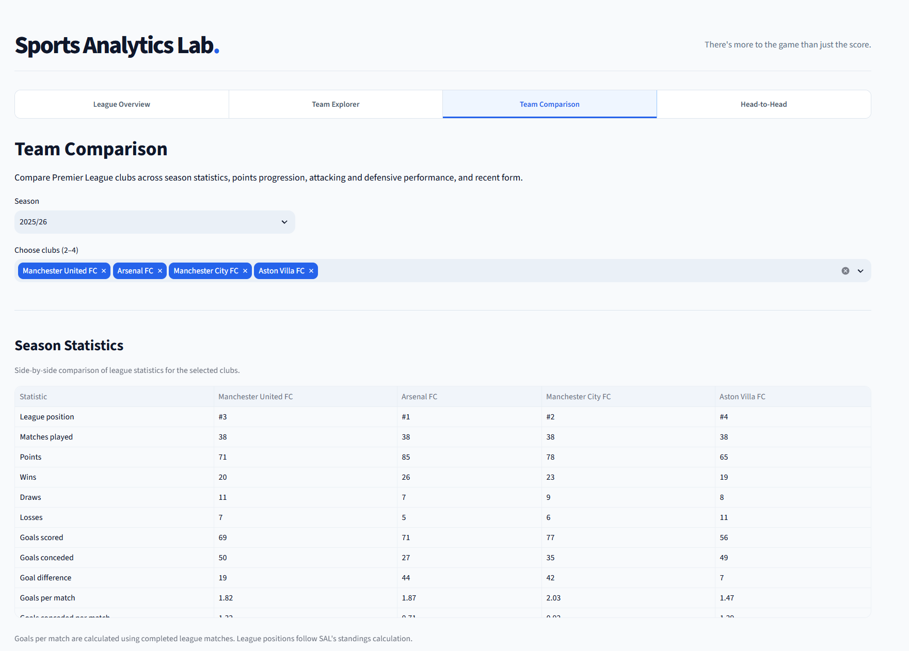
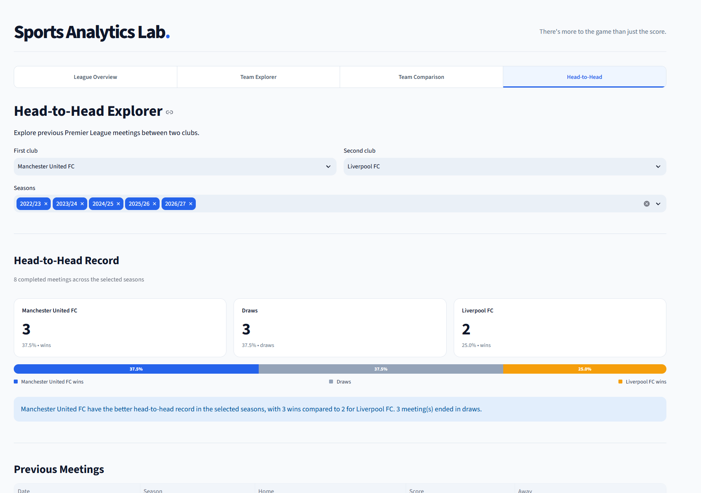

# Sports Analytics Lab

**There's more to the game than just the score.**

An independent, passion-driven sports analytics project exploring how data can help us better understand the sports we love.

**[Explore the Live App](https://sports-analytics-lab.streamlit.app/)**

---

## The Story Behind This Project

I've always enjoyed a wide range of sports, not just watching the action, but also exploring the numbers and stories behind what happens on and off the field.

Whether it's understanding why a football team is performing well, comparing players, or exploring the factors behind sporting success, I've always found the analytical side of sports fascinating.

As someone with a background in Data and Business Analytics, I've also been curious about something else: **how do sports analytics platforms actually work behind the scenes?**

Whenever I explore a sports analytics platform, or see someone else using one, I find myself wondering what it takes to collect, process, analyse, and present all that information in a way that anyone can understand.

So I decided to try building one myself.

Sports Analytics Lab started as a personal portfolio project, but it is equally a passion project. I wanted to challenge myself to build something from the ground up, apply my analytical and technical skills to something I genuinely enjoy, and learn how to turn raw sports data into a working application along the way.

Getting to this stage has involved plenty of learning, experimentation, debugging, and problem-solving.

And frankly, that's what has made the journey so rewarding.

## What Is Sports Analytics Lab?

Sports Analytics Lab is an interactive sports analytics application designed to make sports data more accessible, understandable, and enjoyable to explore.

**Version 0.2.3 continues to focus on the English Premier League**, covering 12 consecutive seasons:

- **2015/16–2025/26:** 11 completed Premier League seasons.
- **2026/27:** The ongoing season, with periodically updated match results.

Rather than simply displaying match results, the application allows users to explore league performance, examine individual clubs, compare teams across seasons, and investigate historical head-to-head records.

All analyses are built from match-level data, with interactive filters and visualisations designed for both desktop and mobile exploration.

### What's New in v0.2?

Version 0.2 significantly expands the scope of the original application.

Key improvements include:

- **Expanded historical coverage:** Premier League match results dating back to 2015/16.
- **Head-to-Head Explorer:** Historical meetings and performance comparisons between two clubs.
- **Enhanced Team Comparison:** Side-by-side statistics, attacking and defensive performance, points progression, and form timelines.
- **League & Club Records:** Winning streaks, unbeaten streaks, clean sheets, home and away performance, and standout matches.
- **Interactive streak history:** Explore the individual matches behind a club's longest winning or unbeaten streak.
- **Automated match updates:** Scheduled data ingestion using GitHub Actions, Python, and Supabase PostgreSQL.
- **Improved data validation:** Historical team-name normalisation, duplicate detection, automated calculation tests, and official points deduction adjustments.

The goal is not simply to add more statistics, but to make it easier to understand the stories behind them.

**A note on product analytics:** Sports Analytics Lab records session-level activity, such as session starts and feature views, to help understand how the application is used. These metrics represent Streamlit sessions rather than unique individual visitors. Ratings and written feedback are optional, with submissions accessible through the internal analytics dashboard.

### Product Feedback & Analytics (v0.2.1–v0.2.3)

Beyond football analytics, recent updates have also focused on understanding how visitors experience Sports Analytics Lab.

- **v0.2.1 — User Feedback:** Introduced an optional rating and comment form, allowing visitors to share their experiences and suggest improvements.
- **v0.2.2 — Product Engagement Tracking:** Added anonymous session and feature-view tracking to understand which parts of the application visitors explore.
- **v0.2.3 — Internal Product Analytics:** Built a password-protected dashboard for reviewing recorded sessions, feature engagement, daily activity, rating distributions, and recent feedback.

The internal dashboard includes date-range filtering and is intended for project administration rather than public access.

These additions help guide future improvements based on actual product usage and visitor feedback.

---

## Explore the Features

### 1. League Overview

Explore how Premier League clubs perform within a selected season.

Features include:

- League standings with wins, draws, losses, goals scored, goals conceded, goal difference, and points.
- Recent form indicators for each club.
- Season-level performance records, including longest winning and unbeaten streaks.
- Clean-sheet leaders and home and away points-per-match records.
- Highest-scoring matches and biggest victories.
- Interactive club rankings with league-average benchmarks.

Historical points deductions are incorporated where applicable, ensuring that league standings reflect verified official adjustments.

### 2. Team Explorer

Take a closer look at an individual club's performance during a selected Premier League season.

Explore:

- League position, points, wins, and goal difference.
- Cumulative points progression across completed matches.
- Recent match form and results.
- Home versus away performance.
- Cross-season points progression, including equal-length comparisons.
- Club records and milestones.
- The match-by-match history behind a club's longest winning and unbeaten streaks.

The Team Explorer aims to move beyond a team's final league position and help explain how its season unfolded.

### 3. Team Comparison

Compare two to four Premier League clubs within the same season.

The comparison tools include:

- Side-by-side season statistics.
- League positions, results, points, and goal differences.
- Goals scored and conceded per match.
- Cumulative points progression.
- Attacking and defensive performance comparisons.
- Interactive form timelines across a selected range of completed matches.

These features make it possible to examine differences in performance, consistency, and results across competing clubs.

### 4. Head-to-Head Explorer

Explore historical Premier League meetings between two clubs across selected seasons.

The Head-to-Head Explorer provides:

- Total completed meetings.
- Wins, draws, and losses for each club.
- Visual summaries of head-to-head results.
- Chronological records of previous meetings.
- Goals scored and average goals per meeting.
- Clean-sheet records.
- Flexible season selection for historical comparisons.

With data extending back to 2015/16, users can explore how rivalries have developed across more than a decade of Premier League football.

---

## How It Works

Beyond its interactive interface, Sports Analytics Lab is designed as an end-to-end data analytics application.

The system combines historical datasets, external APIs, Python-based processing, PostgreSQL storage, and interactive analytics.

### 1. Data Collection & Integration

Premier League match data is collected from two primary sources:

- **OpenFootball:** Historical match results from completed Premier League seasons.
- **football-data.org:** Match results for the ongoing Premier League season.

Data from these sources is standardised into a consistent match-level structure.

### 2. Data Processing & Validation

Python and pandas are used to extract, transform, validate, and prepare the collected data.

Validation includes:

- Checking match and season coverage.
- Identifying duplicate fixtures.
- Verifying scores and participating clubs.
- Standardising historical club names.
- Checking calculated results against known historical reference values.

Historical data is validated before being uploaded to the database.

### 3. Database Storage & Analytics

Validated match records are stored in **Supabase PostgreSQL**.

The Streamlit application accesses the database through a restricted, read-only PostgreSQL connection.

Reusable Python analytics modules calculate league standings, club results, performance comparisons, head-to-head records, and statistical milestones.

This separation between data processing, analytical logic, and application presentation makes the project easier to test, maintain, and extend.

### 4. Automated Data Updates

Current-season results are updated using a scheduled **GitHub Actions** workflow.

The automated pipeline:

1. Retrieves completed matches from football-data.org.
2. Validates the returned data.
3. Compares the results with existing database records.
4. Inserts new matches or updates changed records using PostgreSQL upsert operations.
5. Avoids unnecessary database writes when no changes are detected.

The workflow is scheduled to run four times per day and can also be triggered manually.

Updates are periodic rather than real-time, and their availability depends on the upstream data provider and successful pipeline execution.

### 5. Interactive Application

Streamlit and Plotly transform the processed match data into interactive tables, charts, and analytical views.

The application is deployed through **Streamlit Community Cloud**, with caching used to reduce repeated database queries and improve responsiveness.

### Technology Stack

| Layer                 | Technologies                                  |
| --------------------- | --------------------------------------------- |
| Data ingestion        | Python, Requests, REST APIs                   |
| Data processing       | pandas                                        |
| Data analysis         | Python, pandas, SQL                           |
| Database              | PostgreSQL, Supabase                          |
| Database connectivity | psycopg, Supabase Python client               |
| Workflow automation   | GitHub Actions                                |
| Visualisation         | Plotly                                        |
| Web application       | Streamlit                                     |
| Version control       | Git, GitHub                                   |
| Deployment            | Streamlit Community Cloud                     |
| Testing               | Python assertions, automated regression tests |

Throughout development, I have also used AI tools extensively as a learning and development companion, helping me brainstorm, write and debug code, explore alternatives, and iterate on the application.

Rather than simply relying on generated solutions, I've tried to make this a hands-on learning experience by questioning implementation choices, validating outputs, troubleshooting issues, and making decisions about how the platform should work and evolve.

## Data Sources & Methodology

### Data Sources

Sports Analytics Lab currently uses the following data sources:

**[OpenFootball](https://github.com/openfootball/football.json)**

Historical Premier League match results from 2015/16 through 2025/26. The dataset is provided under CC0/public-domain terms.

**[football-data.org](https://www.football-data.org/)**

Premier League 2026/27 match results, retrieved through the provider's API in accordance with its usage terms.

The application focuses on completed Premier League matches. Scheduled matches without final results are not included in match-performance calculations.

### Limitations

Sports Analytics Lab currently focuses on descriptive and comparative analysis.

It does not yet include detailed player-level performance data, expected goals (xG), advanced event metrics, or predictive modelling.

Standings are calculated independently from match results, with known historical points deductions incorporated. Additional official league tie-breakers are not fully implemented.

The availability and accuracy of analyses also depend on the completeness and consistency of the underlying data sources.

---

## My Vision for Sports Analytics Lab

Although this project starts with football, **my dream has never been to stop at football.**

I enjoy many different sports, and I would love to gradually expand Sports Analytics Lab to cover other interests of mine, including basketball, chess, baseball, badminton, tennis, Formula 1, American football (NFL), and more.

I also hope to take the analytical side much further. Future possibilities include detailed player and athlete statistics, underlying performance metrics, advanced comparisons, predictive models, and eventually financial and operational insights that help explain what happens beyond the scoreboard.

Of course, these dreams will depend on data availability, licensing, technical feasibility, and what I learn along the way.

I'm not trying to build everything at once.

**My goal is to keep learning, keep experimenting, and gradually turn this small personal project into a richer sports analytics platform.**

Version 0.2.3 represents another step in that journey, but there's still so much more I'd love to explore.

---

## Explore & Connect

If you enjoy sports, statistics, or data analytics, I'd love for you to explore the application and share your feedback.

Whether it's a feature suggestion, an interesting analytical question, or an idea for another sport, I'm always happy to learn from different perspectives.

**[Launch Sports Analytics Lab](https://sports-analytics-lab.streamlit.app/)**

*Built out of curiosity, a passion for sports, and a desire to keep learning.*

---

**Sports Analytics Lab · Version 0.2.3**

*An independent personal project. Not affiliated with the Premier League or its clubs.*