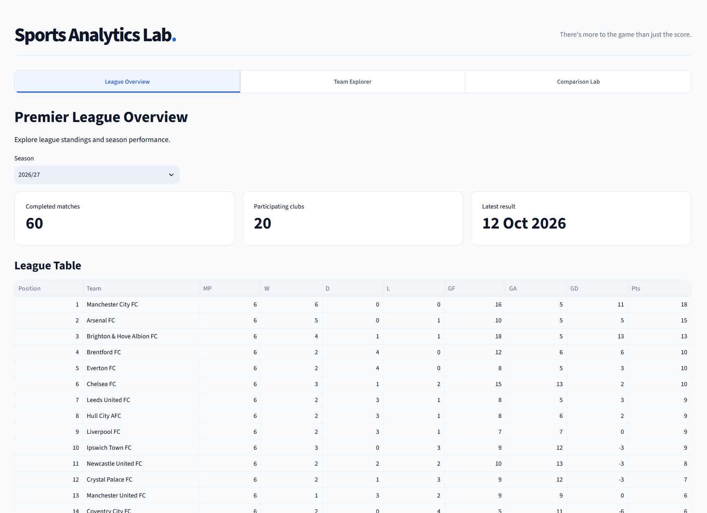
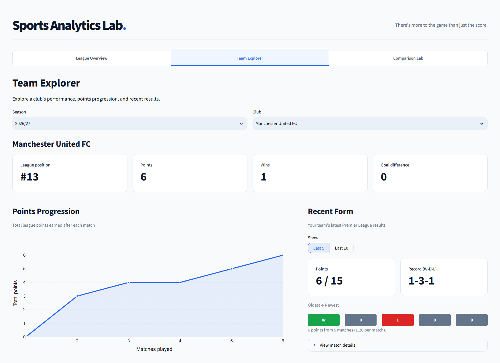

# Sports Analytics Lab

**There's more to the game than just the score.**

An independent, passion-driven sports analytics project exploring how data can help us better understand the sports we love.

**[Explore the Live App](https://sports-analytics-lab.streamlit.app/)**

---

## The Story Behind This Project

I've always enjoyed a wide range of sports, not just watching the action, but also exploring the numbers and stories behind what happens on and off the field.

Whether it's understanding why a football team is performing well, comparing players, or exploring the factors behind sporting success, I've always found the analytical side of sports fascinating.

As someone with a background in Data and Business Analytics, I've also been curious about something else: **how do sports analytics platforms actually work behind the scenes?**

Whenever I explore a sports analytics platform, or see someone else using one, I find myself wondering what it takes to collect, process, analyse, and present all that information in a way that anyone can understand.

So I decided to try building one myself.

Sports Analytics Lab started as a personal portfolio project, but it is equally a passion project. I wanted to challenge myself to build something from the ground up, apply my analytical and technical skills to something I genuinely enjoy, and learn how to turn raw sports data into a working application along the way.

Although this first version is only a starting point, getting here has involved plenty of learning, experimentation, debugging, and problem-solving.

And frankly, that's what has made the journey so rewarding.

## What Is Sports Analytics Lab?

Sports Analytics Lab is an interactive analytics application designed to make sports data more accessible, understandable, and enjoyable to explore.

**Version 0.1 focuses on the English Premier League**, covering three seasons:

- 2024/25
- 2025/26
- 2026/27 (ongoing)

Rather than simply displaying match results, the application allows users to explore team performance, identify trends, and compare clubs and seasons through interactive visualisations.

### Current Features

**League Overview**

Explore Premier League standings and key performance indicators across different seasons.

**Team Explorer**

Take a closer look at individual clubs through cumulative points progression, recent match form, home and away performance, and other team-level statistics.

**Comparison Lab**

Compare multiple clubs within the same season, or explore how a club's performance has evolved across seasons. Users can examine full available season trajectories or compare an equal number of matches.

All analysis is generated from match-level data, with interactive filters and visualisations designed to make exploration intuitive on both desktop and mobile.

## How It Works

Beyond the interface, Sports Analytics Lab is built as an end-to-end data analytics application.

The workflow consists of four main stages:

**1. Data Collection & Integration**

Football match data is collected from external sources, including OpenFootball and football-data.org.

**2. Data Processing & Validation**

Python and pandas are used to standardise different data formats, validate match records, and prepare consistent datasets for analysis.

**3. Database & Analytics**

Processed data is stored in Supabase PostgreSQL. The application retrieves match records through a restricted read-only database connection and calculates performance metrics using Python.

**4. Interactive Application**

Streamlit and Plotly transform the results into an interactive, responsive web application deployed through Streamlit Community Cloud.

### Technology Stack

| Layer | Technologies |
|---|---|
| Data ingestion | Python, Requests |
| Data processing & analysis | pandas, SQL |
| Database | PostgreSQL, Supabase |
| Visualisation | Plotly |
| Application | Streamlit |
| Version control | Git, GitHub |
| Deployment | Streamlit Community Cloud |

Throughout development, I have also used AI tools extensively as a learning and development companion, helping me brainstorm, write and debug code, explore alternatives, and iterate on the application.

Rather than simply relying on generated solutions, I've tried to make this a hands-on learning experience by questioning implementation choices, validating outputs, troubleshooting issues, and making decisions about how the platform should work and evolve.

## Data Sources & Methodology

The current application uses the following sources:

- **OpenFootball:** Premier League 2024/25 and 2025/26 match results, provided under CC0/public-domain terms.
- **football-data.org:** Premier League 2026/27 match data, used in accordance with the provider's terms.

League standings and performance metrics are calculated independently from completed match records.

The application currently focuses on descriptive and comparative analysis. It does not yet incorporate advanced metrics such as expected goals (xG), detailed player statistics, or predictive modelling.

Standings may also differ from official rankings in cases where additional competition tie-breakers are required. Current-season data reflects the latest successfully ingested results rather than a live feed.

## My Vision for Sports Analytics Lab

Although this project starts with football, **my dream has never been to stop at football.**

I enjoy many different sports, and I would love to gradually expand Sports Analytics Lab to cover other interests of mine, including basketball, chess, baseball, badminton, tennis, Formula 1, American football (NFL), and more.

I also hope to take the analytical side much further. Future possibilities include detailed player and athlete statistics, underlying performance metrics, advanced comparisons, predictive models, and eventually financial and operational insights that help explain what happens beyond the scoreboard.

Of course, these dreams will depend on data availability, licensing, technical feasibility, and what I learn along the way.

I'm not trying to build everything at once.

**My goal is to keep learning, keep experimenting, and gradually turn this small personal project into a richer sports analytics platform.**

Version 0.1 is simply the beginning.

## Explore & Connect

If you enjoy sports, statistics, or data analytics, I'd love for you to explore the application and share your feedback.

Whether it's a feature suggestion, an interesting analytical question, or an idea for another sport, I'm always happy to learn from different perspectives.

**[Launch Sports Analytics Lab](https://sports-analytics-lab.streamlit.app/)**

*Built out of curiosity, a passion for sports, and a desire to keep learning.*

---

**Sports Analytics Lab · Version 0.1**

*An independent personal project. Not affiliated with the Premier League or its clubs.*